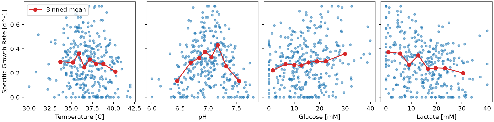
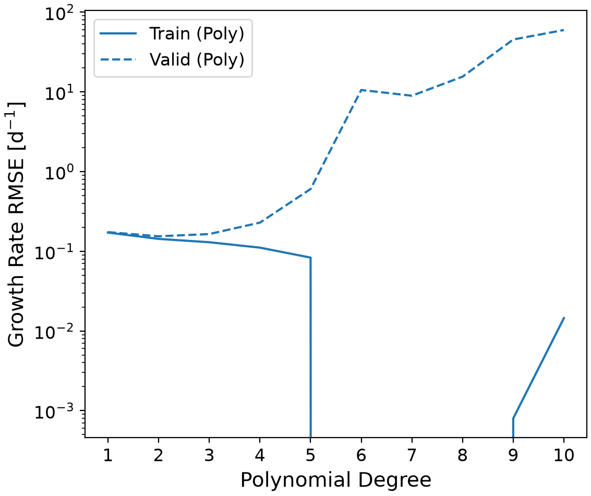
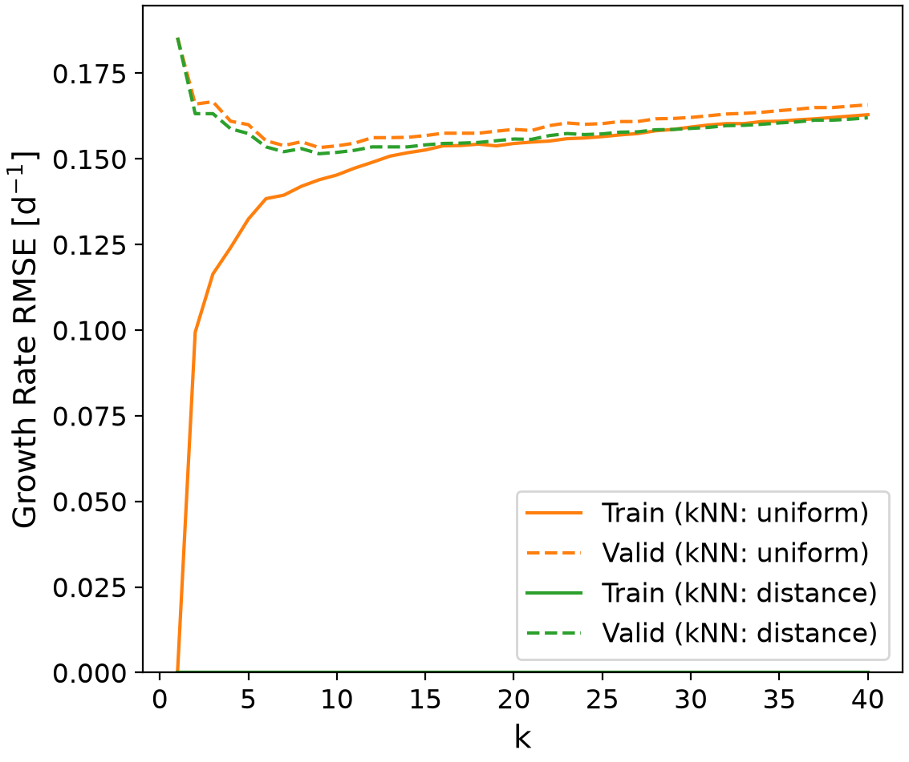
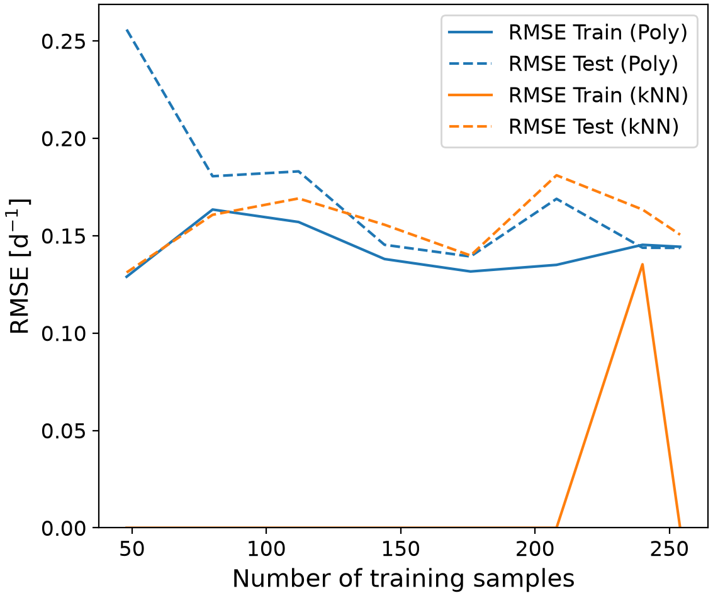
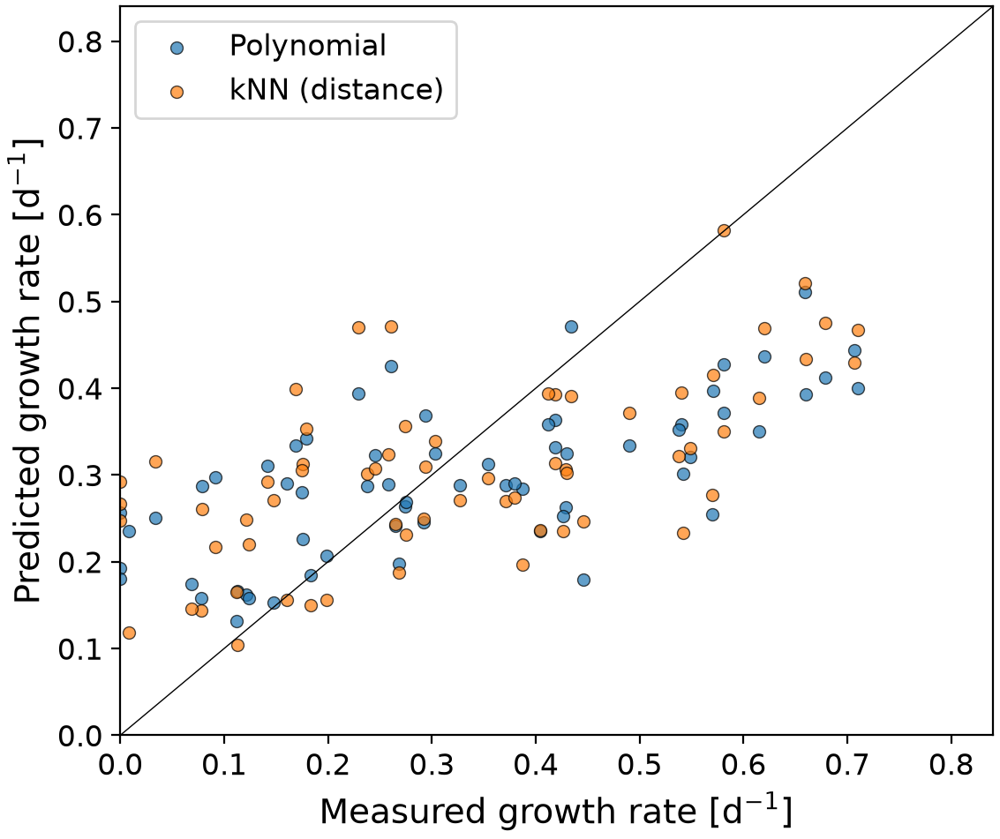
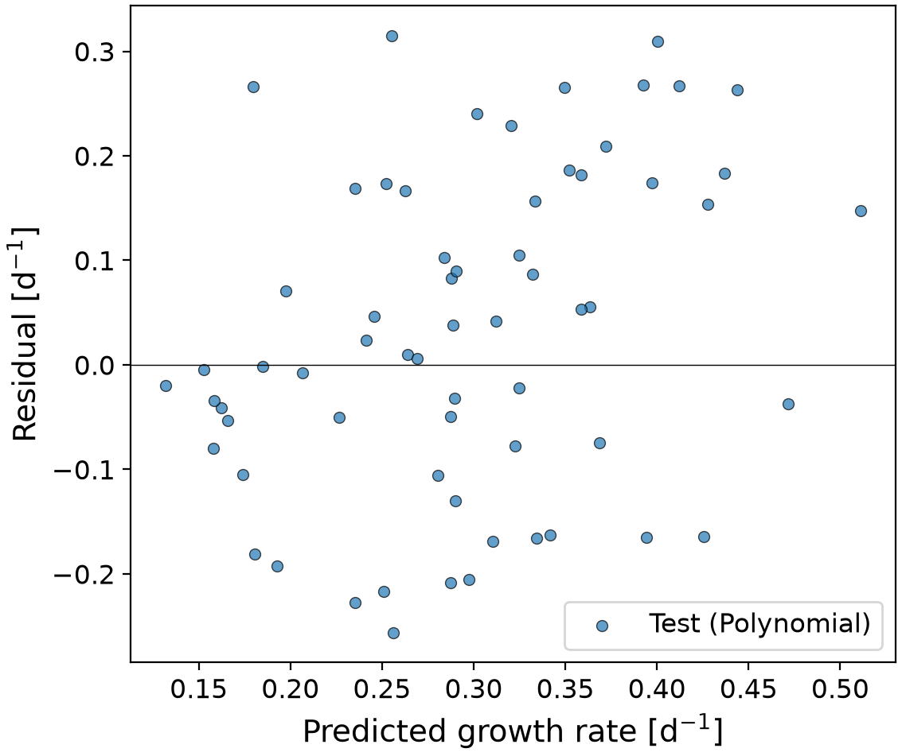
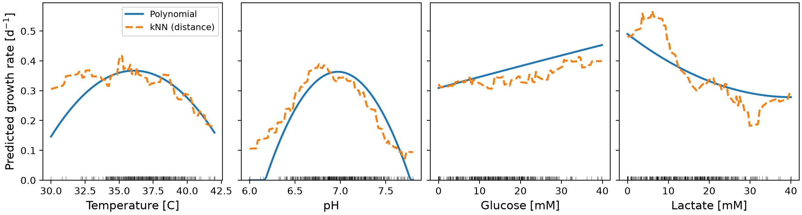
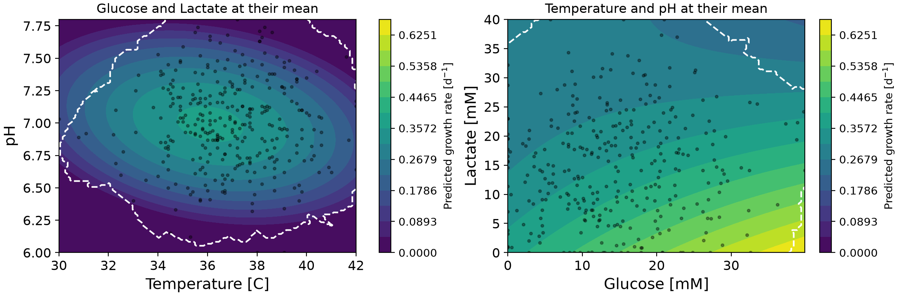

# Cell Growth Prediction Model
Understanding and anticipating cell culture growth is essential for running a bioprocess. This project explores how four environmental conditions :temperature, pH, glucose and lactate shape the specific growth rate. Its goal is to optimise bioprocesses by training and comparing polynomial and k-nearest neighbours models, while checking how reliable the predictions are. Cross-validation, learning curves and a reliability domain are used throughout to avoid unsafe extrapolations and keep the conclusions applicable to biological work.

## Highlights
* Developed an end-to-end regression workflow for bioprocess data
* Tuned polynomial and k-NN models with cross-validated grid search
* Compared models using held-out tests and learning curves
* Interpreted polynomial weights and one-factor response plots
* Mapped reliable operating regions using nearest-neighbor distances

## Environment
* Python 3.14.7
* matplotlib 3.11.0
* numpy 2.5.2
* pandas 3.0.5
* scikit-learn 1.9.0

## Code Design
The project is organised as a sequence of steps, and each step saves its outputs (numbers, tables) to the `figures` and `tables` folders. The `main.py` script simply lays out the order of the steps: file paths, column names, random seeds and hyperparameter ranges all live together in `src/constants.py`, while the actual logic of each step is kept in `src/functions.py.` This separation is deliberate and practical: if you want to try a different search range, you only edit one file, without ever touching the function code.

### Data loading and validation
The workflow starts by reading the CSV file and running a simple check: the five expected columns must exist and no value must be missing. Once validated, the table becomes the single source of data for every following step. This step is necessary because it guarantees that no later step works on incomplete or misnamed data; it contributes to the workflow by providing a reliable, unique base for all analyses.

### Exploratory analysis
The program then summarises each variable (mean, spread, range, number of zeros) and computes the correlation matrix. It also plots histograms and the growth rate against each factor, with, for each factor, the mean growth rate computed in tranches (quantiles) to make the trend visible. This step has three goals: checking that the factors cover a relevant range, spotting possible correlations between factors (which would blur the interpretation later), and seeing whether the relationships are curved. It contributes to the workflow by justifying the choice of models: it is precisely the observed curvature that motivates the use of polynomial and nearest-neighbour models rather than a simple straight line.

### Train / test split
The data is converted into NumPy arrays and then randomly split: 80% of the samples (254) are used for development and 20% (64) are set aside. The test set is used only once, at the very end, to report the final performance. This split is essential: without it, the measured error would reflect the model's ability to memorise the training data, not to generalise. It contributes to the workflow by ensuring that every decision (tuning, selection) relies only on the training set, and that the reported performance is an honest estimate on conditions never seen before. A fixed random seed ensures the split is identical on every run.

### Candidate models
Two model families are defined as pipelines. Polynomial regression standardises the four variables, expands them into powers and interaction terms, then fits a linear regression on this extended set. The k-nearest neighbours (k-NN) model standardises the variables and averages the growth rates of the closest training samples. Standardisation is placed inside the pipeline: at each cross-validation fold, scikit-learn refits the scaler only on the training part, so that validation samples never influence the preprocessing — they do not "leak" into training. It also puts temperature (around 30–42 °C) and lactate (0–40 mM) on comparable scales, which matters for distance calculations and makes the polynomial weights comparable with each other. This step contributes to the workflow by providing two pipelines ready to be tuned in the next step.

### Hyperparameter tuning
Each family has settings that cannot be learned directly from the data: the polynomial degree (1 to 10) and, for k-NN, the number of neighbours (1 to 40) as well as the weighting scheme (uniform or distance-based). A grid search with 4-fold cross-validation is run on the training set: each combination is trained on three folds and evaluated on the fourth using RMSE. The training error is also recorded, because the gap between training and validation error reveals underfitting and overfitting. Separate searches are run for a purely linear model, for the polynomial family, and for each k-NN weighting, so that each alternative is compared with its own best settings. This step contributes to the workflow by producing, for each family, the best set of hyperparameters and its validation error, which will be used directly in the comparison.

### Model comparison and selection
The tuned candidates are compared against a baseline that always predicts the mean growth rate; this shows the real share of the error that the models manage to explain. The final choice follows an explicit rule: the model with the lowest RMSE wins, unless the polynomial is within one standard deviation of it, in which case the polynomial is kept because it is simpler and its weights can be read directly. This step is necessary to decide between models whose performance is statistically close. It contributes to the workflow by designating the model that will be evaluated on the test set and then interpreted; stating the rule makes the selection reproducible and prevents the test set from influencing it.

### Learning curves
To find out whether more experiments would help, the program repeats the fit on random subsets of increasing size, from 60 samples up to the full dataset. Each subset gets its own train/test split and its own grid search, and training and test errors are recorded for both families. This step is a diagnostic, not a decision: it does not affect model selection. It contributes to the workflow by indicating whether the amount of data is sufficient or, on the contrary, whether collecting more data of the same kind would not add much.

### Evaluation on the test set
The selected model and its closest alternative are evaluated on the held-out data with RMSE, mean absolute error and R². The results are shown in a measured-vs-predicted plot and a residual plot. Negative predictions are set to zero, since a growth rate cannot be negative. This step is the only one to use the test set, which guarantees an unbiased estimate. It contributes to the workflow by providing the final performance reported in the README, and by revealing whether the errors are random or systematic (for example, whether high growth rates are consistently underestimated).

### Interpretation

The selected model is then refitted on all 318 samples, so that every observation contributes to the final model. Its weights are exported: since the inputs are standardised, they are directly comparable, with squared terms signalling an optimum and cross terms signalling an interaction. For a view that is independent of the model type, each factor is varied over its observed range while the others are held at their mean, and this is done for both the polynomial and the k-NN model. The two-dimensional maps show the temperature–pH and glucose–lactate relationships. This step is necessary to turn a statistical model into usable biological knowledge. It contributes to the workflow by producing the weights and curves that feed the Analysis section of the README; the fact that two very different model families reach similar conclusions strengthens confidence in the interpretation.

### Operating region and reliability

Finally, the program scans a four-dimensional grid of conditions to identify the highest and lowest predicted growth rates. A condition is only accepted if it is close to the training data, which is measured by the distance to its fifth-nearest sample compared with the typical distances observed in the dataset. The same boundary is drawn on the maps, and the residual error is reported for each quartile of each factor. This step is necessary to separate reliable predictions (interpolation) from dangerous extrapolations. It contributes to the workflow by turning the model from a simple curve fit into a practical guide, while explicitly specifying the zones where it should not be trusted.

## Analysis

### Dataset Overview

The dataset has 318 simulated experiments and no missing values ([`tables/data_summary.csv`](tables/data_summary.csv)). Growth rates go from 0 to 0.75 d⁻¹ with a mean of 0.283 d⁻¹. A total of 24 samples (7.5 %) have exactly zero growth and a few sit exactly at 0.75 d⁻¹, which looks like a measurement floor and ceiling. The four factors are almost uncorrelated with each other (largest |r| = 0.07, [`tables/correlation_matrix.csv`](tables/correlation_matrix.csv)), so their effects can be separated. Their linear correlations with growth are weak: lactate −0.29, glucose +0.18, temperature −0.12, and pH +0.01. The near-zero value for pH is misleading, because a linear correlation cannot detect an optimum. Figure 1 shows growth peaking around pH 7 and dropping on both sides. The temperature signal is noisier, with the lowest growth in the hottest samples.

**Figure 1**-  Growth rate versus each factor. Blue points are individual samples; the red line shows the mean growth rate per quantile bin.

### Choice of Model Architecture
The selected model is a second-degree polynomial regression with standardized inputs, fitted by ordinary least squares and refit on all data for interpretation. Degree 2 was chosen for three reasons. First, the data call for curvature: temperature and pH both show an interior optimum, which only a squared term can represent. Second, cross terms allow interactions such as nutrient limitation by glucose being weakened by lactate inhibition. Third, validation error was lowest at degree 2. With four features this model has only 14 weights for 254 training samples (about 18 samples per weight), so no extra regularization was needed.

**Table 1**- Training and validation error for polynomial degrees 1 to 6

|Degree|Train RMSE|Valid RMSE|Valid RMSE SD|Train R2|Valid R2    |
|------|----------|----------|-------------|--------|------------|
|1     |0.1717    |0.1739    |0.008        |0.123   |0.0841      |
|2     |0.143     |0.1542    |0.0104       |0.3922  |0.283       |
|3     |0.1299    |0.1645    |0.018        |0.4987  |0.1871      |
|4     |0.1111    |0.2289    |0.058        |0.6329  |-0.6757     |
|5     |0.0833    |0.6043    |0.088        |0.7927  |-10.245     |
|6     |0.0       |10.5678   |1.9979       |1.0     |-3414.5163  |
|7     |0.0       |8.9491    |1.6196       |1.0     |-2521.5482  |
|8     |0.0       |15.53     |4.8509       |1.0     |-7996.9822  |
|9     |0.0008    |45.4061   |8.5678       |0.9999  |-62176.8604 |
|10    |0.0145    |59.7274   |13.7556      |0.9922  |-113868.3134|

Training error keeps falling as the degree rises, but validation error is lowest at degree 2 and then gets worse, with degree 3 already less accurate and less stable. At degree 6 the model has 209 terms, more than the roughly 190 training samples in each fold, so it reproduces the training data perfectly (training RMSE of 0) and fails on new data. This is a clear case of overfitting, and Figure 2 shows the gap opening.

**Figure 2** - Training and validation RMSE versus polynomial degree (log scale). Validation error is minimised at degree 2 and explodes for degree ≥ 4.

### Comparison with Linear and k-NN Models

Every candidate was tuned on the training set only and then scored once on the held-out test set (Table 2).

**Table 2.** Comparison of all candidate models

|Model          |Hyperparameters          |Valid RMSE|Valid RMSE SD|Train RMSE|Test RMSE|Test MAE|Test R2|
|---------------|-------------------------|----------|-------------|----------|---------|--------|-------|
|Baseline (mean)|none                     |0.1838    |0.0118       |0.1835    |0.2068   |0.1707  |-0.0686|
|Linear         |degree = 1               |0.1739    |0.008        |0.172     |0.1907   |0.1643  |0.0917 |
|Polynomial     |degree = 2               |0.1542    |0.0104       |0.1414    |0.157    |0.1309  |0.3841 |
|kNN (uniform)  |k = 9, weights = uniform |0.1533    |0.0113       |0.1418    |0.1621   |0.1363  |0.3434 |
|kNN (distance) |k = 9, weights = distance|0.1515    |0.0112       |0.0       |0.1587   |0.1341  |0.3707 |

The linear model underfits: its training and validation errors are nearly equal (0.172 and 0.174) but both are high, and its test R² is only 0.09. The curvature captured by degree 2 lowers validation RMSE by about 11 % relative to the linear model. The k-NN models reach the same accuracy range. The best k is 9 for both weightings, with validation RMSE of 0.1533 (uniform) and 0.1515 (distance). Distance weighting gives a training RMSE of exactly 0, because each training sample is its own nearest neighbor at distance zero and is reproduced perfectly, so it memorizes the noise in the training data even though its validation error is similar.

**Figure 3.** Training and validation RMSE versus k for both k-NN weightings. The training curve for distance weighting lies on the horizontal axis (RMSE of 0).

The gap between the best k-NN model and the polynomial in validation RMSE (0.0027 d⁻¹) is far smaller than the fold-to-fold standard deviation (about 0.010 d⁻¹), and on the test set the polynomial is slightly better (0.1570 versus 0.1587 d⁻¹). The two families are therefore tied on accuracy, and I chose between them on other grounds. The polynomial is described by 15 numbers, gives smooth predictions, and can be read for optima and interactions. The k-NN model has to store all the samples, gives staircase-like surfaces, and can never predict outside the range of growth rates it has seen. I selected the polynomial. Both families cut the test RMSE by only 22 to 24 % compared with the mean baseline (0.2068 d⁻¹), so most of the variability is not explained by these four factors.

### Learning Curve
The learning curve repeats the whole tuning procedure on subsets of 60 to 318 samples.

**Figure 4.** Training and test RMSE versus the number of training samples. Source: [`tables/learning_curve.csv`](tables/learning_curve.csv).

With 48 training samples the polynomial test RMSE is 0.256 d⁻¹, since there is too little data to estimate the curvature. From 144 samples onward the polynomial always selects degree 2 and its test RMSE stays between 0.14 and 0.17 d⁻¹. The k-NN test RMSE stays between 0.13 and 0.18 d⁻¹ (the lowest value comes from a test set of only 12 samples), and its training RMSE is 0 in seven of eight cases. Both curves level off, so more data of the same kind is unlikely to help much; new factors or less noisy measurements probably would. The curves are noisy because every point uses a different subset and a different small test split, as the bump at 208 samples shows, so only the overall trend should be trusted.

### Model Performance and Residuals
On the 64 held-out samples the selected model reaches an RMSE of 0.157 d⁻¹, a mean absolute error of 0.131 d⁻¹, and an R² of 0.384. About 42 % of test predictions fall within ±0.1 d⁻¹ of the measurement and 77 % within ±0.2 d⁻¹. The cross-validated R² (0.283) is lower than the test R², and with only 64 test samples both values are uncertain, so a realistic expectation is an R² between roughly 0.3 and 0.4.

**Figure 5** - Measured versus predicted growth rate on the test set, for the polynomial and k-NN models.

**Figure 6.** Residuals of the polynomial model on the test set.

The errors are not random. The predictions are squeezed toward the middle: they stay between about 0.1 and 0.5 d⁻¹ while measured values reach 0.7 d⁻¹, so high growth rates are underestimated and low ones overestimated (samples measured at zero are predicted at roughly 0.2 to 0.25 d⁻¹). The residuals also fan out as the predicted rate increases, reaching about ±0.3 d⁻¹. The model is therefore better suited to ranking conditions and showing trends than to predicting one individual culture.

### Influence of Temperature, pH, Glucose, and Lactate

**Table 3**- Largest weights of the selected polynomial model with standardized inputs

|Term                     |Weight |
|-------------------------|-------|
|Intercept (baseline)     |0.3631 |
|[pH]^2                   |-0.0645|
|[Lactate]                |-0.0615|
|[Glucose]                |0.0318 |
|[Temperature]^2          |-0.0244|
|[Temperature]            |-0.0199|
|[Glucose] * [Lactate]    |-0.0194|
|[Temperature] * [pH]     |-0.0187|
|[Lactate]^2              |0.0112 |
|[Temperature] * [Glucose]|-0.0111|
|[pH]                     |-0.0098|
|[Temperature] * [Lactate]|-0.007 |
|[pH] * [Glucose]         |-0.0056|
|[pH] * [Lactate]         |0.0051 |
|[Glucose]^2              |-0.0002|

The intercept (0.363 d⁻¹) is the predicted growth rate at average conditions, and every other term modifies it. The largest weight is the squared pH term, which indicates a strong optimum in pH. With the other factors at their means, predicted growth peaks at pH 6.97 (0.364 d⁻¹) and falls to zero below about pH 6.2 and above about pH 7.8, so pH has the largest effect of the four factors.

**Figure 7.** Predicted growth rate when one factor varies and the others stay at their mean. The tick marks at the bottom show where the training samples are.

* **pH** has the largest effect. The squared pH term is the biggest weight, and growth peaks near pH 7 at about 0.37 d⁻¹, falling to zero below about pH 6.2 and above about pH 7.8.
* **Lactate** inhibits growth. Its weight is the second largest and negative, and predicted growth falls from about 0.49 d⁻¹ at 0 mM to 0.28 d⁻¹ at 40 mM, mostly within the first 20 mM.
* **Temperature** has an optimum near 36 °C (about 0.37 d⁻¹), and growth declines above about 38 °C in both models. The low-temperature side is less certain: the polynomial drops to 0.15 d⁻¹ at 30 °C while the k-NN stays near 0.3 d⁻¹, and only 8 samples lie below 33 °C.
* **Glucose** helps, with predicted growth rising from about 0.31 to 0.45 d⁻¹ across its range. It is the smallest of the four effects.
* **Interactions** matter. The negative glucose–lactate weight means glucose helps most when lactate is low, and the right map in Figure 8 shows the best growth in the high-glucose, low-lactate corner. The negative temperature–pH weight means the best pH shifts slightly lower as temperature rises.

The k-NN model agrees with the polynomial on the direction of every effect and on the optima of temperature and pH, so these conclusions do not come from the polynomial form alone. The two models differ mainly at the edges of the ranges, where data are sparse.

**Figure 8** - Predicted growth rate in the temperature–pH and glucose–lactate planes. The dashed white line encloses the reliable region

### Operating Conditions and Reliability

A search over the region covered by the data (5th to 95th percentile of each factor, restricted to conditions near real samples) gives the summary in Table 4. The first row is the single best condition; the other rows give the median and, in parentheses, the 5th to 95th percentile range of the top and bottom 2 % of conditions.

**Table 4**- Predicted growth rate and conditions of the best, high-growth, and low-growth groups

|Group                 |N  |Predicted growth rate|Temperature [C]    |pH              |Glucose [mM]       |Lactate [mM]       |
|----------------------|---|---------------------|-------------------|----------------|-------------------|-------------------|
|Best single condition |1  |0.599                |35.83              |6.92            |28.83              |0.00               |
|High growth (top 2%)  |991|0.531                |36.27 (34.09-38.89)|6.92 (6.70-7.23)|26.77 (20.59-28.83)|0.00 (0.00-4.40)   |
|Low growth (bottom 2%)|991|0.059                |39.76 (34.52-40.20)|7.53 (6.47-7.53)|14.41 (0.00-26.77) |24.21 (13.21-30.81)|

**High growth** (about 0.5 to 0.6 d⁻¹) needs a temperature of 34 to 39 °C (median 36), a pH of 6.7 to 7.2 (median 6.9), almost no lactate (below about 4.4 mM), and fairly high glucose (21 to 29 mM). **Low growth** (below about 0.1 d⁻¹) appears with high lactate (13 to 31 mM) together with a warm culture near 40 °C and a pH near 7.5, which is the upper edge of the searched range. Even the best predicted rate (0.60 d⁻¹) is below the highest measured value (0.75 d⁻¹), another sign that predictions are pulled toward the mean.

**Predictions are not reliable** in these situations:

* **Extremes of one factor.** Few samples lie below 33 °C (8), above 40.5 °C (10), below pH 6.45 (13), above pH 7.55 (15), above 30 mM glucose (13), or above 30 mM lactate (21).
* **Combinations of extremes.** With four factors the space is sparse, so many combinations, such as high glucose with high lactate, are far from any sample. The dashed line in Figure 8 shows where this starts.
* **Outside the studied ranges.** A quadratic eventually turns downward, so values beyond 30 to 42 °C, pH 6.0 to 7.8, and 0 to 40 mM for glucose and lactate should not be trusted.
* **Zero growth.** The 24 zero-growth samples appear even under ordinary conditions, so they cannot be predicted from these four factors.

The error by quartile ([`tables/reliability_by_range.csv`](tables/reliability_by_range.csv)) stays between 0.127 and 0.162 d⁻¹, so no range is dramatically worse. It is highest where growth is highest, for example lactate below 7.35 mM (0.162), glucose above 20.4 mM (0.161), and temperature between 36.9 and 38.3 °C (0.160).

### Advantages and Limitations

The polynomial is simple, fast, and interpretable: 15 numbers describe the whole model, optima and interactions can be read directly, training takes a fraction of a second, and its accuracy matches the more flexible k-NN model. Its smooth predictions also suit optimization.

Its limitations are just as clear. It explains only about 30 to 40 % of the variance and compresses extreme growth rates toward the mean. It can only clip negative values and cannot represent the floor at 0 and the ceiling at 0.75 d⁻¹. A quadratic forces symmetric optima and extrapolates poorly. Only four factors are included, so oxygen, other nutrients, or cell age are absorbed into the noise. The test set is small (64 samples), so the performance estimate is itself uncertain, and the data are simulated, so a real culture may behave differently.

### Potential Applications

The model can screen operating windows before running experiments, for example to decide which pH and temperature setpoints are worth testing and to narrow the design space of a new process. It can support feeding strategies by showing the trade-off between glucose supply and lactate buildup: keeping lactate low, for instance with controlled feeding or medium exchange, lets a high glucose level pay off. In a monitoring system it could give the expected growth rate for the current readings, so a large deviation flags a possible process problem. It could also supply growth-rate estimates to larger bioprocess simulations. In every case, predictions should stay inside the reliable region, and a new process would need the model to be retrained on its own data.